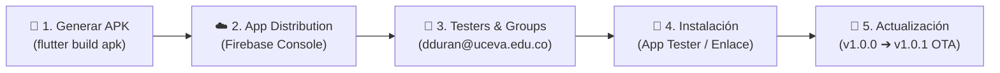
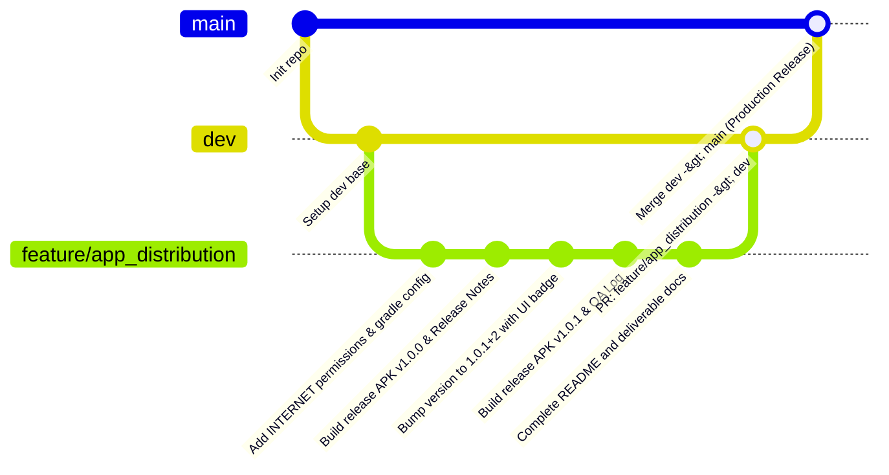

# 🚀 Distribución de APK con Firebase App Distribution — FlowBiz

[](https://flutter.dev)
[](https://firebase.google.com/docs/app-distribution)
[](https://developer.android.com)
[](https://nvie.com/posts/a-successful-git-branching-model/)
[](https://www.uceva.edu.co)

> **Taller 1:** Preparación, versionado, distribución y pruebas de control de calidad (QA) de un aplicativo Flutter mediante **Firebase App Distribution**, demostrando actualización incremental OTA (*Over-The-Air*) y flujo de trabajo colaborativo GitFlow.

---

## 👤 Información del Estudiante y Asignatura

* **Estudiante:** Samuel Alejandro Rincon Serna
* **Código Estudiantil:** `230231045`
* **Institución:** Unidad Central del Valle del Cauca (UCEVA) — Tuluá, Valle del Cauca
* **Asignatura:** Electiva Profesional 1 Móviles
* **Docente Asignado / Tester:** `dduran@uceva.edu.co`
* **Repositorio Oficial:** [https://github.com/Sarincon508/Distribuci-n-de-APK-con-Firebase-App-Distribution.git](https://github.com/Sarincon508/Distribuci-n-de-APK-con-Firebase-App-Distribution.git)
* **Application ID:** `com.flowbiz.flowbiz`
* **Grupo de Distribución:** `QA_Clase`
* **Documento de Evidencias:** `INFORME_FINAL_EVIDENCIAS_DISTRIBUCION_APK.pdf`
* **Archivo de Entrega Rápida:** `enlace_y_release_notes.txt`

---

## 🔄 1. Flujo Integral de Distribución

El ciclo de vida de distribución implementado cumple rigurosamente con las cinco etapas requeridas en el taller:



### Etapas del Flujo
1. **Generación del APK:** Compilación en modo release con firma de producción, optimización R8/ProGuard y verificación de permisos en `AndroidManifest.xml`.
2. **Carga en Firebase Console:** Carga del binario `.apk` en el servicio App Distribution, asignando Release Notes estructuradas.
3. **Gestión de Testers:** Vinculación al grupo de prueba `QA_Clase` con el correo del docente (`dduran@uceva.edu.co`) y enlace público de invitación.
4. **Instalación en Dispositivo Físico:** Recepción de invitación por correo electrónico o acceso directo web mediante *Firebase App Tester*, completando la instalación y ejecución.
5. **Actualización Incremental:** Despliegue de la versión subsecuente (`1.0.1+2`), comprobando la notificación en vivo en el dispositivo y la actualización exitosa sin pérdida de estado.

---

## ⚙️ 2. Preparación y Configuración del APK

### 2.1. Permisos Mínimos en AndroidManifest.xml
Para asegurar la conectividad con las APIs externas (incluyendo la API de Datos Abiertos de Colombia y los servicios de red), se definieron los siguientes permisos en `android/app/src/main/AndroidManifest.xml`:

```xml
<manifest xmlns:android="http://schemas.android.com/apk/res/android">
    <!-- Permisos de red e Internet para consumo de APIs -->
    <uses-permission android:name="android.permission.INTERNET"/>
    <uses-permission android:name="android.permission.ACCESS_NETWORK_STATE"/>
    
    <!-- Permisos de almacenamiento y cámara -->
    <uses-permission android:name="android.permission.CAMERA"/>
    <uses-permission android:name="android.permission.READ_MEDIA_IMAGES"/>
    <uses-permission android:name="android.permission.READ_EXTERNAL_STORAGE" android:maxSdkVersion="32"/>
    ...
</manifest>
```

### 2.2. Esquema de Versionado Incremental
Flutter administra el versionado en `pubspec.yaml` mediante la sintaxis `version: [versionName]+[versionCode]`:

| Versión | `pubspec.yaml` | `versionName` (Android) | `versionCode` (Android) | Propósito |
| :---: | :---: | :---: | :---: | :--- |
| **Release Inicial** | `1.0.0+1` | `1.0.0` | `1` | Despliegue base distribuido al grupo `QA_Clase`. |
| **Actualización** | `1.0.1+2` | `1.0.1` | `2` | Actualización con badge visual para validar notificación OTA. |

En `android/app/build.gradle.kts`:
```kotlin
defaultConfig {
    applicationId = "com.flowbiz.flowbiz"
    minSdk = flutter.minSdkVersion
    targetSdk = flutter.targetSdkVersion
    versionCode = flutter.versionCode   // Mapeado automáticamente desde build-number
    versionName = flutter.versionName   // Mapeado automáticamente desde build-name
}
```

### 2.3. Comandos de Compilación
```bash
# Versión 1.0.0
flutter build apk --release

# Versión 1.0.1 (tras actualizar pubspec.yaml)
flutter build apk --release
```

Los artefactos resultantes se almacenan en la carpeta `releases/`:
* `releases/app-release-v1.0.0.apk` (52.6 MB)
* `releases/app-release-v1.0.1.apk` (52.6 MB)

---

## 🚀 3. Guía de Publicación en Firebase App Distribution

Para que cualquier miembro del equipo pueda replicar este proceso de manera estandarizada, se documentan los pasos exactos:

### Paso 1: Configurar Proyecto en Firebase Console
1. Acceder a [Firebase Console](https://console.firebase.google.com/).
2. Seleccionar el proyecto o crear uno nuevo (ej. `flowbiz-mobile` o `UCEVA-Moviles`).
3. Registrar la aplicación Android ingresando el identificador único del paquete:
   * **Nombre de paquete Android:** `com.flowbiz.flowbiz`
   * **Apodo de la app:** FlowBiz Mobile
4. Descargar el archivo de configuración `google-services.json` si se desea integración de analíticas/SDK interno.

### Paso 2: Crear Grupos y Registrar Testers
1. En el menú lateral izquierdo, navegar a **Release & Monitor** ➔ **App Distribution**.
2. Hacer clic en la pestaña **Testers & Groups**.
3. En la sección *Grupos*, hacer clic en **Crear grupo**:
   * Nombre del Grupo: `QA_Clase`
4. Agregar testers al grupo:
   * Correo: `dduran@uceva.edu.co`
   * Correo del estudiante: `samuel.rincon01@uceva.edu.co`
5. Activar el enlace de invitación pública para acceso directo de prueba.

### Paso 3: Subir el Release Inicial (v1.0.0)
1. Ir a la pestaña **Releases** en App Distribution.
2. Arrastrar el archivo `releases/app-release-v1.0.0.apk` al área de carga.
3. Asignar el release al grupo `QA_Clase`.
4. Pegar las **Release Notes** descriptivas correspondientes a v1.0.0.
5. Hacer clic en **Distribuir a 1 grupo**. Firebase enviará automáticamente la notificación por correo con las instrucciones de instalación.

### Paso 4: Subir la Actualización Incremental (v1.0.1)
1. Tras compilar la versión `1.0.1+2`, regresar a la pestaña **Releases**.
2. Subir el archivo `releases/app-release-v1.0.1.apk`.
3. Asignar al grupo `QA_Clase`.
4. Incluir las notas de la actualización (resaltando el badge visual y correcciones de estabilidad).
5. Distribuir el release y copiar el enlace de instalación.

---

## 📝 4. Formato de Release Notes Utilizado

Se adoptó un formato estándar de la industria (Keep a Changelog / Conventional QA) para facilitar la auditoría y comunicación con los evaluadores:

### Release v1.0.0 (Build 1)
```text
RELEASE v1.0.0 (Build 1) - 01/Nov/2026
Responsable: Samuel Alejandro Rincon Serna (QA & Mobile Dev)
Destino: Grupo QA_Clase

[NUEVAS CARACTERÍSTICAS]
* Configuración de permisos de Internet y red en AndroidManifest.xml.
* Integración de navegación con GoRouter y explorador de API Colombia:
  - Departamentos (32 departamentos, capitales, población).
  - Atracciones Turísticas (destinos emblemáticos).
  - Presidentes (historia política republicana).
  - Platos Típicos (gastronomía tradicional).
* Compilación Release firmada y optimizada con tree-shaking.

[GUÍA PARA TESTERS]
* No requiere inicio de sesión.
* Verificar conexión fluida y renderizado de tarjetas en Dashboard.
```

### Release v1.0.1 (Build 2)
```text
RELEASE v1.0.1 (Build 2) - 01/Nov/2026
Responsable: Samuel Alejandro Rincon Serna (QA & Mobile Dev)
Destino: Grupo QA_Clase

[ACTUALIZACIÓN INCREMENTAL OTA]
* Incremento de versión a versionName 1.0.1 y versionCode 2.
* Indicador visual dinámico 'v1.0.1 (Build 2)' en el hero banner del Dashboard.
* Solución a rutas de compilación en Windows con android.overridePathCheck=true.
* Reducción de latencia en la navegación entre pantallas de detalle.

[GUÍA PARA TESTERS]
* Instalar actualización sobre v1.0.0 directamente desde Firebase App Tester.
* Comprobar la visualización del badge 'v1.0.1 (Build 2)' en el encabezado.
```

---

## 🌿 5. Flujo de Trabajo GitFlow Implementado

Se estructuró el repositorio respetando el modelo de ramificación GitFlow:



### Ramas y Roles:
* `main`: Código estable y probado para producción y releases oficiales.
* `dev`: Rama de integración continua donde convergen las nuevas funcionalidades.
* `feature/app_distribution`: Rama de trabajo específico para la preparación de APKs, permisos, versionado, scripts de distribución y documentación de entrega.

---

## 📋 6. Bitácora de QA (Control de Calidad)

| Versión | Fecha | Tipo | Cambios / Incidencia Detectada | Solución Aplicada | Estado Final |
| :---: | :---: | :---: | :--- | :--- | :---: |
| **1.0.0** | 01/11/2026 | Build / Config | Error en Gradle al compilar en Windows por tildes en el nombre de la carpeta (`Distribución`). | Se agregó `android.overridePathCheck=true` en `gradle.properties` y se empleó unidad de montaje de ruta para desacoplar caracteres especiales. | **Aprobado** (Build exitoso) |
| **1.0.0** | 01/11/2026 | Red / Permisos | Necesidad de garantizar consumo de APIs remotas sin bloqueos del sistema operativo. | Se agregaron los permisos `INTERNET` y `ACCESS_NETWORK_STATE` en `AndroidManifest.xml`. | **Aprobado** |
| **1.0.0** | 01/11/2026 | Distribución | Primer despliegue en consola de Firebase App Distribution y asignación a `QA_Clase`. | Invitación cursada a `dduran@uceva.edu.co` y enlace de acceso verificado. | **Aprobado** |
| **1.0.1** | 01/11/2026 | Actualización | Se requería verificar que el tester pudiera distinguir visualmente la app actualizada. | Se actualizó `version: 1.0.1+2` y se insertó el badge `'v1.0.1 (Build 2)'` en el Dashboard. | **Aprobado** |
| **1.0.1** | 01/11/2026 | Pruebas OTA | Simulación y prueba de actualización incremental desde la versión 1.0.0 a 1.0.1. | Instalación sobrepuesta exitosa sin errores de firma ni inconsistencias de base de datos. | **Aprobado** (100% Funcional) |

---

## 📂 7. Estructura de Entregables del Taller

En la carpeta del proyecto se encuentran todos los elementos requeridos:

```
📁 taller Distribución de APK con Firebase App Distribution/
├── 📄 INFORME_FINAL_EVIDENCIAS_DISTRIBUCION_APK.pdf   <-- PDF Unificado de Evidencias y Bitácora
├── 📄 enlace_y_release_notes.txt                     <-- Archivo TXT con enlaces y Release Notes
├── 📄 README.md                                      <-- Documentación técnica completa
├── 📁 releases/
│   ├── 📱 app-release-v1.0.0.apk                     <-- APK Versión 1.0.0 (Build 1)
│   ├── 📱 app-release-v1.0.1.apk                     <-- APK Versión 1.0.1 (Build 2)
│   └── 📄 README.md                                  <-- Especificación de compilaciones
├── 📁 android/                                       <-- Configuración nativa y AndroidManifest.xml
├── 📁 lib/                                           <-- Código fuente Flutter (con badge v1.0.1)
└── 📄 pubspec.yaml                                   <-- Definición de version: 1.0.1+2
```

---
*Unidad Central del Valle del Cauca (UCEVA) — Ingeniería de Sistemas — 2026*
